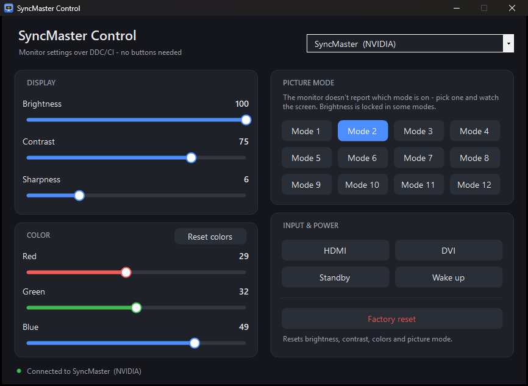

# DDC Monitor Control

**Control your monitor's settings from Windows when its physical buttons are broken.**

A small, portable Windows app (one 43 KB `.exe`, nothing to install) that changes brightness, contrast, sharpness, colors, picture mode, input and power on your monitor. It talks to the monitor through the video cable using the **DDC/CI** protocol.



---

## The problem

My Samsung SyncMaster PX2370's touch buttons stopped working. The panel itself is fine, but without buttons there was no way to reach the on-screen menu. Brightness was stuck at 100, the picture mode couldn't be changed, and the colors couldn't be adjusted. Replacing a working monitor because of a dead button strip felt wasteful.

Nearly every monitor made since the mid-2000s supports **DDC/CI**, which lets the computer read and change monitor settings over the HDMI/DVI/DisplayPort cable. Windows has a built-in way to use it, but:

- **On many laptops it doesn't work.** On laptops with both Intel and NVIDIA graphics (NVIDIA Optimus), Windows' DDC/CI calls often fail with an I2C transmit error. The monitor never gets the command.
- **Existing tools are either generic or vendor-locked.** Vendor tools (like Samsung MagicTune) are discontinued or only work with specific models. Generic tools show raw VCP codes and don't handle monitor quirks.
- **Monitors bend the standard.** The PX2370, for example, accepts brightness changes but reports its brightness as `255 / 100` in some picture modes. It uses non-standard input source values and doesn't report its current picture mode.

## The solution

DDC Monitor Control:

1. **Talks to the monitor through the NVIDIA driver (NvAPI I2C)** first. That bypasses the Windows path that fails on hybrid-graphics laptops. For other GPUs it falls back to the standard Windows DDC/CI API (`dxva2`).
2. **Handles the monitor's quirks.** When the monitor reports an impossible value it remembers the last value you set, it uses the monitor's real input codes, and it tells you when something isn't reported.
3. **Gives you a clean, modern UI.** Sliders apply live while you drag, it works with the keyboard and mouse wheel, has a dark theme and is DPI-aware.
4. **Is fully portable.** One `.exe`, no installer, no runtime to download. It uses the .NET Framework that's already part of Windows 10 and 11.

## Features

| Section | Controls |
|---|---|
| Display | Brightness, Contrast, Sharpness |
| Color | Red, Green, Blue gain, Reset colors |
| Picture mode | All 12 picture modes the monitor supports |
| Input & power | HDMI, DVI, Standby, Wake up, Factory reset |

- Live updates while dragging sliders (rapid changes are combined so the monitor isn't flooded)
- Remembers your last settings in `SyncMasterControl.ini` next to the `.exe`
- Asks for confirmation before switching to an input that may have no signal, and before a factory reset
- Monitor picker if you have more than one display

## Download & run

1. Download **`SyncMasterControl.exe`** from the [latest release](../../releases/latest).
2. Double-click it. That's it.

Windows SmartScreen may warn you because the app isn't code-signed. Click **More info, then Run anyway**. If you'd rather not trust a binary, [build it yourself](#build-from-source) from the source in this repo.

**Requirements:** Windows 10 or 11 (64-bit), and a monitor connected by HDMI, DVI or DisplayPort with DDC/CI enabled (it's on by default on most monitors).

## Supported monitors

| Vendor | Model | Status |
|---|---|---|
| Samsung | SyncMaster PX2370 | ✅ Supported and tested |
| Samsung | Other SyncMaster models | 🔜 Coming soon (basic controls likely work already) |
| Dell | | 🔜 Coming soon |
| LG | | 🔜 Coming soon |
| ASUS | | 🔜 Coming soon |
| BenQ | | 🔜 Coming soon |
| Acer | | 🔜 Coming soon |
| AOC | | 🔜 Coming soon |
| HP | | 🔜 Coming soon |
| Lenovo | | 🔜 Coming soon |

Brightness, contrast and RGB use standard DDC/CI codes, so they often work on other monitors already. **Multi-vendor support is coming soon.** It will read each monitor's capabilities and show the right controls, input names and picture modes for that model. If you'd like your monitor supported sooner, [open an issue](../../issues) with its model name and the output of the command-line tool below.

## How it works

DDC/CI sends small packets over the I2C wires inside the video cable to the monitor at address `0x37`. Each setting has a **VCP code** defined by the VESA MCCS standard:

| VCP code | Setting | PX2370 notes |
|---|---|---|
| `0x10` | Brightness | Some picture modes report `255/100`; the app shows the last value set |
| `0x12` | Contrast | Reported correctly |
| `0x87` | Sharpness | Range 0–25 |
| `0x16` / `0x18` / `0x1A` | Red / Green / Blue gain | |
| `0x08` | Restore color defaults | |
| `0x04` | Restore factory defaults | |
| `0xDC` | Picture mode | Values `01–06`, `F0–F2`, `F9–FB`; current mode isn't reported |
| `0x60` | Input source | `03` = DVI, `05` = HDMI (non-standard) |
| `0xD6` | Power mode | `01` = on, `04` = standby |
| `0x8A` | Saturation | Not supported by the PX2370 |

The app sends these codes through:

- **NVIDIA NvAPI** (`NvAPI_I2CWriteEx` / `NvAPI_I2CReadEx`) for displays driven by an NVIDIA GPU. It builds the DDC/CI packets and checksums itself.
- **Windows Monitor Configuration API** (`GetVCPFeatureAndVCPFeatureReply` / `SetVCPFeature` in `dxva2.dll`) for everything else.

## Command-line tool

[`MonitorControl.ps1`](MonitorControl.ps1) does the same from PowerShell. It's useful for shortcuts, scripts, and checking what your monitor supports:

```powershell
# List monitors and their current values
powershell -ExecutionPolicy Bypass -File MonitorControl.ps1 -List

# Read / write any VCP code
powershell -ExecutionPolicy Bypass -File MonitorControl.ps1 -Get 0x12
powershell -ExecutionPolicy Bypass -File MonitorControl.ps1 -Set 0x10 -Value 60
```

## Build from source

No SDK needed. The build uses the C# compiler that ships with Windows:

```powershell
powershell -ExecutionPolicy Bypass -File src\build.ps1
```

This creates `SyncMasterControl.exe` in the repo root (and generates `src\app.ico` if it's missing).

```
.
├── src/
│   ├── SyncMasterControl.cs   # App: DDC/CI backends + UI
│   ├── build.ps1              # Builds the portable .exe
│   └── app.ico                # App icon
├── MonitorControl.ps1         # Command-line tool
└── docs/screenshot.png
```

## Known limitations

- Picture modes are shown as "Mode 1–12" because the PX2370 doesn't report their names or which one is active.
- Saturation isn't available on the PX2370 (it doesn't support VCP `0x8A`).
- The DVI input switch hasn't been tested on hardware yet.
- 64-bit Windows only.

## Roadmap

- [ ] Multi-vendor support: per-model profiles for Dell, LG, ASUS, BenQ, Acer, AOC, HP, Lenovo *(coming soon)*
- [ ] Read the monitor's capability string and show only the controls it supports
- [ ] AMD GPU I2C backend (ADL) for laptops where Windows DDC/CI fails
- [ ] System tray icon with quick brightness control and hotkeys
- [ ] Saved presets (e.g. Day / Night)

## Contributing

Issues and pull requests are welcome, especially reports from other monitor models. Please include the monitor model and the output of `MonitorControl.ps1 -List`.

## Disclaimer

This changes monitor settings through a standard protocol and doesn't modify firmware. Still, use it at your own risk. Factory reset restores the monitor's own defaults.

## License

[MIT](LICENSE.md) © 2026 Sid
